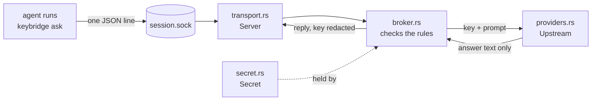

# Reading this crate for the first time

One idea per step. Each step names one file and one thing to look at. Stop
after any step; they build on each other but none is long.

## Step 0 — run it

```sh
cargo run -- demo --guided
```

`cargo` is Rust's build tool. `cargo run` compiles the program and runs it.
Everything after `--` goes to the program, not to cargo.

## The picture



The agent only ever touches the socket on the left. The key stays on the right.

## Step 1 — `Cargo.toml`: the project file

Like `pyproject.toml` or `package.json`. It names the crate (Rust's word for a
package) and lists the libraries it uses. `Cargo.lock` pins their exact versions.

## Step 2 — `src/main.rs` and `src/lib.rs`: program and library

`main.rs` is the program: a dozen lines. `lib.rs` is the library: a list of
modules, one per file. The tests use the library directly, which is why the
logic lives there.

## Step 3 — `src/secret.rs`: ownership and `Drop`

The main idea in Rust. Every value has exactly one **owner**. When the owner
goes away, Rust **drops** the value: it runs cleanup code right then, not at
some later garbage-collection time.

`Secret` uses that. Its cleanup overwrites the key with zeros. So "the session
ended" and "the key's memory was wiped" are the same moment.

Try it: in the test at the bottom of the file, add `println!("{secret}");` and
run `cargo test`. It will not compile: `Secret` has no `Display`. Printing the
key is not a bug you can write by accident. Remove the line again.

## Step 4 — `expose(&self) -> &str`: borrowing

`&` means **borrow**: look at a value without becoming its owner. `expose`
lends out the key text for a moment. The compiler checks the loan ends before
the `Secret` is dropped. Search the crate for `expose` to see every place the
key is read. There are few.

## Step 5 — `src/policy.rs`: `enum` and `match`

`enum Provider` is a fixed list of choices: Moonshot, OpenRouter, Gemini.
`match` handles each one. If a fourth provider is added and one `match` forgets
it, the program does not compile. The compiler finds the gap.

## Step 6 — `Policy::with_limits`: `Result`

Rust has no exceptions. A function that can fail returns a `Result`: either
`Ok(value)` or `Err(error)`. The caller has to deal with both.

`Policy`'s fields are private, so the only way to make one is this function,
and it checks every limit. A `Policy` that exists is a valid one.

## Step 7 — the `?` at the end of a line

`something()?` means: if it failed, return that error from this function now;
otherwise keep the value and continue. Look in `src/cli.rs`, function
`live_broker`. Each `?` is one early exit.

## Step 8 — `src/broker.rs`, `struct Session`: `Option`

No `null` in Rust. A value that might be missing is an `Option`: `Some(value)`
or `None`. The key is `Option<Arc<Secret>>`. Lock, expiry and a used-up
allowance all call `Session::end`, which sets it to `None`. That drop is what
wipes the key (step 3).

## Step 9 — `src/providers.rs`, `trait Upstream`: traits

A trait is an interface: "anything that can send one request". There are three:
the real HTTP client, the demo's fake, and the tests' fake. The broker cannot
tell them apart, so its rules are tested with no network at all.

## Step 10 — `Mutex` and `Arc`: sharing between threads

Several requests can arrive at once. `Mutex<Session>` lets one thread at a
time change the session. `Arc` lets several threads hold the same value; it is
dropped when the last holder lets go. Rust will not compile code that shares
changing data between threads without something like these.

In `try_handle` the lock is taken twice, briefly: once to reserve an attempt,
once to record the outcome. It is not held during the slow provider call.

## Step 11 — `src/transport.rs`, `impl Drop for Server`

The same idea as step 3, used for a file. When the `Server` goes away, for any
reason, it locks the broker and removes its socket file. There is no cleanup
call to forget.

## Step 12 — tests

A function marked `#[test]` is a test. `cargo test` runs all of them: the small
ones at the bottom of each `src/` file and the larger ones in `tests/`.

```sh
cargo test lock
```

runs only tests with "lock" in the name. Start with
`tests/broker_rules.rs`; the test names say what each rule is.

## Step 13 — `#![forbid(unsafe_code)]` in `lib.rs`

Rust's safety checks can be switched off inside an `unsafe` block. This line
makes the compiler reject any such block in this crate.

## Words you will see

| Word | Meaning |
| --- | --- |
| crate | a package |
| `struct` | a record with named fields |
| `impl` | the functions that belong to a type |
| `pub` | visible outside the file |
| `&` | borrowed, not owned |
| `mut` | allowed to change |
| `Vec<T>` | a growable list |
| `String` / `&str` | owned text / borrowed text |
| `Box<dyn Trait>` | "some value that implements this trait" |
| `'static`, `'_` | lifetimes: how long a borrow may last. Safe to skim past at first. |
